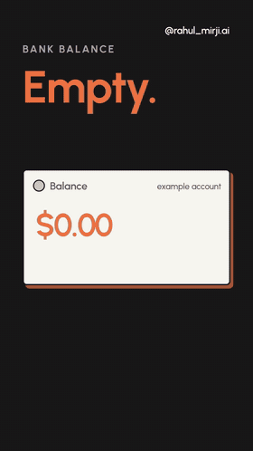

# 🎬 Tech Topic Differences (`tech-topic-differences`)

[](LICENSE)
[](https://www.python.org/downloads/)
[](https://playwright.dev/)
[](https://ffmpeg.org/)
[](#)

> **The AI Agent Skill & Motion Graphics Engine for Tech Creators.**  
> Turn any "A vs B" tech comparison (Docker vs Kubernetes, Git vs GitHub, CI vs CD, REST vs gRPC, SQL vs NoSQL) into high-retention, viral 9:16 vertical motion-graphics reels ready for Instagram, TikTok, YouTube Shorts, and LinkedIn.

---

## 📱 See It In Action

<div align="center">

<table>
  <tr>
    <td align="center" width="50%">
      
      <br/><strong>🎥 Final Output (Creator Talking)</strong>
    </td>
    <td align="center" width="50%">
      
      <br/><strong>🐳 Docker vs Kubernetes</strong>
    </td>
  </tr>
  <tr>
    <td align="center" width="50%">
      
      <br/><strong>🔄 CI vs CD</strong>
    </td>
    <td align="center" width="50%">
      
      <br/><strong>🗃️ SQL vs NoSQL</strong>
    </td>
  </tr>
</table>

</div>

---

## ⚡ What is this?

**`tech-topic-differences`** is an end-to-end framework and AI Agent Skill built specifically for tech content creators, developer advocates, and educators. 

Explaining differences between two developer tools or concepts is one of the highest-converting video formats in tech. However, hand-crafting motion graphics in After Effects takes hours per reel. This project reverse-engineers viral tech reels into a deterministic, high-speed HTML/SVG/Playwright rendering pipeline driven by a structured Agent Skill.

### Key Highlights

* 🎯 **Creator-First Half-Screen Layout**: Outputs 1080×1920 (9:16) vertical MP4s where **only the top half (1080×960)** contains graphics. The bottom half is left as a clean `#F7F5EF` cream canvas for the creator's talking-head webcam.
* 🔄 **Signature "Focus-Swap" Motion**:
  1. Two persistent white boxes pop in side-by-side with hard drop shadows.
  2. The yellow **"WHAT'S THE DIFFERENCE?"** hook punches through.
  3. Box A glides to **BIG** mode, explaining concept A piece-by-piece.
  4. Seamless 0.9s glide swap into Box B as the narration pivots.
  5. Both boxes glide back side-by-side into a neutral comparison settle.
* 📚 **64-Pair Topic Guide Built-in**: Ready-to-render recipes spanning DevOps, Cloud, AI/ML, System Design, Security, and Networking.
* 📦 **Automatic Official Vector Logos**: Fetches real SVGs via `tools/logo.py` directly from Simple Icons, Devicon, and Lobe Icons—fitted precisely by true bounding box.
* ⏱️ **Retention Cadence**: Enforces a movement beat every ≤ 0.7s (packets moving, progress meters, reflow cascades) so the concept is intuitive even with the sound off.
* 🤖 **AI-Agent Ready**: Built according to the Antigravity / Claude Agent Skill specification (`SKILL.md`). Feed your agent a topic or raw script, and it writes the config, lints it, and renders the video automatically.

---

## 📐 Anatomy of an "A vs B" Reel

```
0.00s  NEUTRAL STATE: Box A pops in  -> Box A label fades in
0.75s  NEUTRAL STATE: Box B pops in  -> Box B label fades in
1.80s  HOOK: Hard cut -> Yellow "WHAT'S THE DIFFERENCE?" pops with 12% overshoot
2.68s  FOCUS A: Box A smoothly expands to BIG (covers top half)
       Pieces build progressively (0.3s - 1.2s intervals matching voiceover)
5.70s  FOCUS SWAP: Box A glides back left; Box B scales up into center
       Pieces for B build progressively (code cards, pipelines, diagrams)
9.70s  SETTLE: Box B glides right -> Both completed diagrams shown side-by-side
10.9s  CUT / NEXT PAIR
```

---

## 🎨 8 Visual Archetypes (64 Topics)

Every tech comparison fits into one of 8 battle-tested visual archetypes:

| Archetype | Visual Metaphor | Typical Kit Builders | Example Pairs |
|---|---|---|---|
| **FLOW** | Components, arrows & moving packets | `stack` (trail), `IC.tower`, `IC.db`, `IC.tree`, `pkt` | Docker vs K8s, API Gateway vs Load Balancer |
| **TIME** | Timelines, handshakes & async waits | `pkt` (staggered), `CHIP`, `spin` fx, `countNum` | Sync vs Async, TCP vs UDP, Stateless vs Stateful |
| **SPEED** | Latency, throughput & meter fill rates | `meter` (fill duration), `pkt` speed, `countNum` | Cache vs Database, Latency vs Throughput |
| **SHAPE** | Data structures, schemas & layers | `ROW`, `IC.json`, `IC.docs`, `FRAME`, `IC.scatter` | SQL vs NoSQL, Monolith vs Microservices |
| **ROLE** | Who acts (Human vs AI, Client vs Server) | `stack` (trail), `IC.avatar`, `BTN`, `IC.code` | Vibe Coding vs Traditional, Chat vs Agent |
| **TEXT** | Prompts, tokens, system context | `PROMPT`, `BUB`, `CHIP`, `typeText` | Prompting vs Fine-Tuning, System vs User Prompt |
| **RISK** | Security, outcomes, shields vs bugs | `IC.ok/no/warn`, `IC.secure`, `IC.badge` | HTTP vs HTTPS, Authentication vs Authorization |
| **LOOP** | Cycles, feedback & iterative stages | `IC.cycle`, `spin`, repeated steps | DevOps vs MLOps, CI vs CD |

Explore all 64 pre-planned pairs in [`reference/topics.md`](reference/topics.md).

---

## 🚀 Quick Start

### 1. Prerequisites

* **Python 3.9+**
* **Playwright** (Chromium headless engine)
* **FFmpeg**

```bash
# Install Python dependencies
pip install playwright

# Install browser binaries
playwright install chromium

# Ensure ffmpeg is available
brew install ffmpeg       # macOS
# or: sudo apt install ffmpeg  # Ubuntu/Debian
```

### 2. Clone the Repository

```bash
git clone https://github.com/RahulMirji/tech-topic-differences.git
cd tech-topic-differences
```

### 3. Generate Official Logos

Fetch official brand vector marks for your comparison tools:

```bash
python3 kit/tools/logo.py git github docker kubernetes redis postgresql --out kit/assets/logos
```

### 4. Build & Preview a Scene

```bash
cd kit

# Compile engine + config into a standalone HTML scene
python3 build.py examples/git_vs_github.config.js scene.html

# Run layout linter (checks bounding boxes, collisions, font sizing)
python3 tools/lint.py scene.html

# Generate preview contact sheet at key timestamps
python3 preview.py pv/contact_sheet.png 0.5 2.2 4.5 8.0 10.5
```

### 5. Render to 1080×1920 MP4

```bash
python3 render.py scene.html out.mp4

# Run automated QA check (verifies 1080x1920, silent audio, bottom half fill)
python3 tools/qa.py out.mp4
```

The resulting `out.mp4` is crisp 60fps/30fps video ready to be imported into CapCut, Premiere, or DaVinci Resolve under your camera track!

---

## 🛠️ Config API (Declarative Motion)

Videos are defined using simple JavaScript timeline configurations (`config.js`). All timings are expressed in seconds:

```javascript
window.DURATION = 13.0;

/* 1. INTRO: Side-by-side logo tiles */
boxPop('L', 0.00);
boxPop('R', 0.75);
tile('L', 0.00, 'git', 'white', '#F05032', { fit: 0.78 });
tile('R', 0.75, 'github', 'white', '#24292F', { fit: 0.78 });
label('L', 0.12, 'Git', { until: 1.80 });
label('R', 0.87, 'GitHub', { until: 1.80 });

/* 2. HOOK: What's the difference? */
wtd(1.84, 2.68);
cut(2.68);

/* 3. FOCUS A: Git expands to BIG */
focus('L', 2.68);
label('L', 3.00, 'Git', { dur: 0.3, until: 6.20, out: 0.25 });
add('L', { at: 3.10, kind: 'wipe', x: 20, y: 18, w: 240, h: 30, html: TX('Local Version Control', 21, 800) });
add('L', { at: 3.50, kind: 'pop', x: 20, y: 62, w: 240, h: 76, html: gitTimelineSVG });
add('L', { at: 4.20, kind: 'pop', x: 22, y: 154, w: 236, h: 36, html: CHIP('Installed on your computer', '#fff', '#F05032', 14) });

cut(6.20);

/* 4. FOCUS B: GitHub scales up into focus */
focus('R', 6.20);
label('R', 6.55, 'GitHub', { dur: 0.3, until: 9.80, out: 0.25 });
add('R', { at: 6.65, kind: 'wipe', x: 15, y: 18, w: 250, h: 30, html: TX('Cloud Hosting & Collab', 21, 800) });
add('R', { at: 7.00, kind: 'pop', x: 20, y: 62, w: 240, h: 76, html: prCardSVG });
add('R', { at: 7.60, kind: 'pop', x: 22, y: 154, w: 236, h: 36, html: CHIP('Code Review & Pull Requests', '#fff', '#1E9E55', 14) });

cut(9.80);

/* 5. SETTLE: Both finished boxes side-by-side */
neutral(9.80);
label('L', 10.05, 'Git', { dur: 0.3 });
label('R', 10.05, 'GitHub', { dur: 0.3 });
```

---

## 🤖 Using as an AI Agent Skill

This repository functions as an official agent skill compliant with the [Antigravity Customization System](https://github.com/google) and Claude Code skill format.

### Installation in Antigravity or Claude Code

Copy this directory into your skill path:

```bash
# Global skills directory
cp -r tech-topic-differences ~/.gemini/antigravity/builtin/skills/
# Or for project-specific skills:
cp -r tech-topic-differences .agent/skills/
```

### Prompting Your Agent

Once loaded, you can ask your agent:

> *"Create a 12-second reel explaining the difference between Redis and PostgreSQL for caching vs persistent storage. Use our tech-topic-differences skill."*

The agent will:
1. Parse the speech cadence into timed beats (default 3 words/sec).
2. Choose the optimal archetype (`SPEED` / `SHAPE`).
3. Fetch brand logos via `logo.py`.
4. Compose `config.js` with entrance animations and reflow stacks.
5. Lint the layout and render the finished `out.mp4`.

---

## 📂 Project Structure

```
tech-topic-differences/
├── SKILL.md                  # Complete Agent Skill prompt & operational manual
├── README.md                 # Project documentation & guide
├── kit/                      # Standalone generation kit
│   ├── build.py              # Inlines assets & config into HTML template
│   ├── preview.py            # Generates timestamped preview contact sheets
│   ├── render.py             # Playwright headless frame capture & FFmpeg encoding
│   ├── engine.tpl.html       # Core animation engine, stage & CSS tokens
│   ├── motion.js             # Animation primitives, fx, reflow stacks, packet loops
│   ├── builders.js           # SVG component builders (containers, servers, chips)
│   ├── builders2.js          # Extended builders (system design, AI avatars, code)
│   ├── tools/
│   │   ├── plan.py           # Auto-generates timed timeline skeleton from script
│   │   ├── logo.py           # Real official logo scraper (SimpleIcons, Devicon)
│   │   ├── lint.py           # Visual collision & boundary linter
│   │   ├── qa.py             # Video QA checker (resolution, silence, hold times)
│   │   └── compare.py        # Frame-by-frame diff tool against reference videos
│   ├── assets/
│   │   ├── fonts/            # Bundled Poppins font families (500-900)
│   │   ├── icons/            # 43+ bundled Lucide concept icons
│   │   └── logos/            # Official brand SVGs
│   └── examples/
│       ├── docker_vs_k8s.config.js     # Pair 1: Containers vs Orchestration
│       ├── patterns_demo.config.js     # Pair 2: CI/CD, Scaling, REST/gRPC
│       ├── topics_demo.config.js       # 10-pair comprehensive archetype demo
│       └── git_vs_github.config.js     # Git vs GitHub version control reel
└── reference/
    ├── topics.md             # 64 curated tech pair scripts & visual plans
    ├── topics.json           # Machine-readable topic dataset
    ├── measurements.json     # Measured coordinates & timings from reference reels
    └── frames/               # Reference comparison keyframes
```

---

## 🤝 Contributing

Contributions are welcome! If you'd like to add new topic recipes to `reference/topics.md` or new reusable SVG builders to `kit/builders2.js`:

1. Fork this repository.
2. Create a feature branch (`git checkout -b feature/new-topic`).
3. Ensure `python3 kit/tools/lint.py` passes.
4. Open a Pull Request.

---

## 📄 License

This project is licensed under the [MIT License](LICENSE).
Official trademarks and logos fetched by `tools/logo.py` remain the property of their respective owners and are utilized for editorial comparison purposes.

